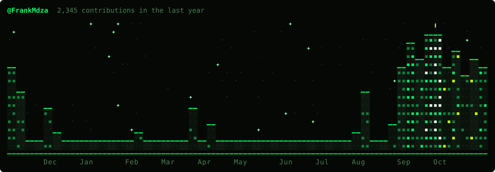

  

---

- 🔥 Frank, AKA Fr4nk
- 🏛️ Founder of HephaestusLab: harnesses and skills for coding agents
- 💻 Software engineer at Third Way Health
- 🐉 Building [Hydra](https://github.com/FrankMdza/hydra-harness), a Rust harness that runs Claude Code, Codex, Gemini and Cursor behind a policy gate and records every run
- 🧩 Problem solver from Colombia 🇨🇴

  

---

---

- **Cybersecurity 🔐 • Music 🎧 • Art 🎨 • Breaking agents to see what they do 🧪**

---

- **Rust • Python • SQL • LLM agents • macOS seatbelt**

---

- 💼 LinkedIn: [franciscomdzah](https://www.linkedin.com/in/franciscomdzah/), for HephaestusLab work and hiring
- 🐙 GitHub: [@FrankMdza](https://github.com/FrankMdza)
- 🛠️ Probably reading an agent's run record to see why it lied about passing the tests

---

Young, broke and fabulous. Fund the slop, keep me in the loop.

